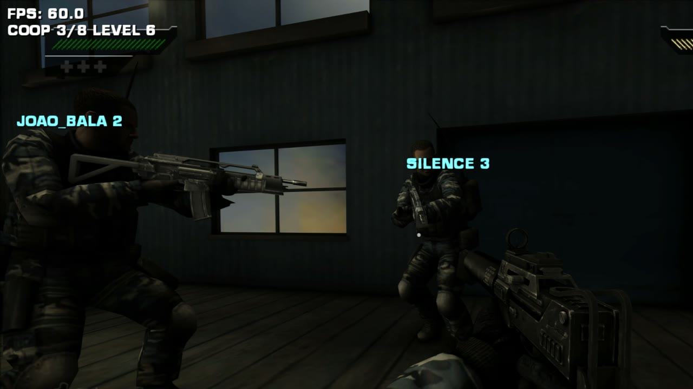
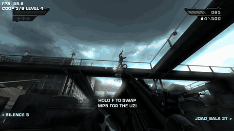
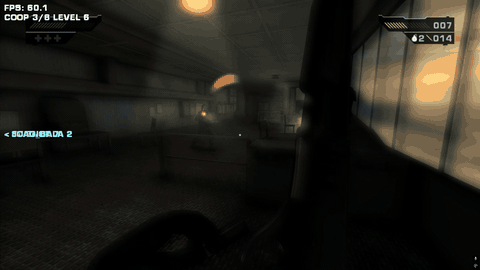

# Black Seamless Co-op

🇧🇷 [Leia em português](README.pt-BR.md)



Play the campaign of **Black** (Criterion, 2006) together with up to **8 players**, on PC.

This is a mod for [BLACK-XBERecomp](https://github.com/TGP482/BLACK-XBERecomp), an unofficial native PC
port of the original Xbox game (a static recompilation made with
[XboxXBE-Recomp](https://github.com/TGP482/XboxXBE-Recomp)). Black never had multiplayer: everything here
is built on top of the game's own code, so expect rough edges (me and my friends beat the game and everything we found was fixed).

> **You need your own copy of Black (Xbox, USA release).** This repository contains only the co-op code.
> It has no game files and no code from the port or the recompiler.

---

## Quick start

1. **Download** the latest `BLACK-Seamless-Coop-*.zip` from
   [Releases](https://github.com/MuriloDagustin/black-seamless-coop/releases/latest).
2. **Extract** it anywhere (not inside *Program Files*).
3. **Put your own copy of Black** in the `assets` folder: the `.iso` file, or the extracted disc files.
4. **Run `BLACK.exe`**, press **F10 → CO-OP**, and host or join.

That's it: no installer, no tools. Everyone must use **the same release**.

The release plays over LAN or by IP. Online rooms by code (Epic Online Services) are not in it; see
[Online rooms](#online-rooms) below.

## Playing together

<p align="center">
  
  
</p>

Press **F10 → CO-OP** in the game:

- **One player hosts.** Their game runs the enemies and the mission; everyone else follows it.
- **The others join**: pick the host from the list (same network) or type the host's IP address.
- Joining players are taken to the host's mission, difficulty and progress automatically, even halfway
  through a level.

Over the internet the host must be reachable on **UDP port 45410**: a port forward on the host's router
(with `BLACK.exe` allowed through the Windows firewall), or a virtual LAN such as Tailscale or ZeroTier.

### Online rooms

**Rooms by code** (no port forwarding) work through Epic Online Services, but only in a build you make
yourself with your own free Epic developer account and the EOS SDK. See [docs/online.md](docs/online.md)
and [Build it yourself](#build-it-yourself).

### Controls

| | Keyboard / mouse | Controller |
|---|---|---|
| F10 menu: co-op, settings, key bindings | **F10** | |
| Sprint | **Shift** while moving forward | |
| Get me out of here: go to a teammate | **F8** | **L3 + R3** held for a second |
| While down: watch the next teammate | **click**, **Space** or **→** (**←** the previous one) | **A** or the D-pad |

The sprint speed is set next to the key bindings in the F10 menu (**SPRINT SPEED**, 100% to 250%,
140% by default).

### Co-op rules

- **Dying is not the end.** A player who dies is *down*: the mission goes on and they watch a living
  teammate. They come back when the team reaches the next area or completes an objective.
  The mission fails only when **everyone** is down.
- **Areas load for everyone.** Whoever reaches the next area's door first waits there until the others
  arrive. If you get lost or stuck, press **F8**.
- **Shared progress.** Objectives, secondary pickups (blackmail, intel...), mission failed, continue,
  restart and level complete count for everyone.
- **Everyone's progress is saved.** After a mission each player's game shows its own save screens; a
  joining player goes through them before following the host to the next mission. With no profile yet,
  the game asks for a name there.

## What works

| | |
|---|---|
| Up to 8 players | a host-run session, a nickname over every teammate |
| Teammates | each one is a soldier that walks, runs, crouches and aims as they do |
| Shooting | teammates' bullets hit, break and kill on your screen too, with muzzle flash, tracer and gunshot |
| Enemies | run by the host; they see, hear and shoot every player |
| World | deaths, crates, barrels, breakable scenery, grenades, rockets and area triggers are the same for everyone |
| Level flow | areas, objectives, mission failed / continue / restart / complete together |
| Lives | down, spectate a teammate, revive at the next checkpoint |
| Pause | a teammate in the pause menu stays visible, marked PAUSED |

Not yet: cutscenes in sync, vehicles.

## Problems?

- **Can't connect:** everyone must run the same build. Check the host's port forward and firewall
  (UDP 45410), or use a virtual LAN.
- **The game closed:** send `logs\black.log` (next to `BLACK.exe`) and the newest file in `CrashDumps`,
  if there is one. The log of the previous session is kept as `logs\black.prev.log`.
- **Stuck, or the next area didn't load:** press **F8** to go to a teammate.

---

## For developers

### Build it yourself

Only needed to change the code or to add online rooms. Install Windows 10/11 64-bit,
[git](https://git-scm.com/download/win), [Python 3](https://www.python.org) and Visual Studio 2022 or later with
*Desktop development with C++*, *C++ Clang tools* and *C++ CMake tools*, then:

```
setup.bat black-recomp "C:\path	o\Black.iso"
black-recompuild.bat
```

The game is `black-recomp\outuild
elease\BLACK.exe`. The first build recompiles the whole game and
takes a while.

### What the setup does

`setup.bat [folder] [Black.iso]` clones the port into `black-recomp` (or the folder you name) and the
recompiler SDK into its `sdk` folder at pinned commits, applies `patches/upstream.patch` (the mod's changes
to the port's own files) and copies `src/game/coop*` (the co-op itself). With a disc image it extracts the
game with `tools/xiso_extract.py`; otherwise put `default.xbe`, `GlobData.bin` and the `chars`, `data`,
`export`, `language`, `levels`, `sound` and `videos` folders in the port's `assets` folder yourself.

### Command line

```
BLACK.exe --coop host                      host on UDP 45410
BLACK.exe --coop join --join 192.168.0.10  join that host
```

Two copies on one PC, for testing (`display_mode = 'windowed'` in `black.toml`):

```
BLACK.exe --instance 1 --coop host
BLACK.exe --instance 2 --coop join --join 127.0.0.1 --mute
```

| Option | |
|---|---|
| `--coop host` / `--coop join` | role, for this copy only (`coop = 1` or `2` in `black.toml` for a default) |
| `--join <address>` | the host to join (or `join_ip`) |
| `--coop-port <n>` | the host's UDP port (or `coop_port`), 45410 by default |
| `--coop-world <n>` | world sync level: 6 everything (default) down to 0 off |
| `--instance <n>` | another copy on one PC, with its own saves (`hddN`) and log |
| `--mute` | no sound |
| `--coop-probe` / `--coop-echo` | an on-screen readout / your own state echoed back as a fake partner |
| `--coop-control [port]` | a local test channel (127.0.0.1, 45500 + instance) that drives the copy |

The test channel takes one text command per UDP datagram (`state`, `page`, `pad`, `stick`, `teleport`,
`stand`, `rescue`, `die`, `revive`, `watch`, `sprint`, `flow fail|complete`, `mission`, `peek`...); the
scripts in `tools/` use it for automated multi-copy tests.

### How it works

The port lets host code replace any recompiled function. The mod wraps, among others:

- the frame function `0x20F6A0`: packets in before the frame, each player's state out after it;
- the player's bullets `0x1DB7B0`/`0x1DBD50`: fired again on every copy with the game's own bullet code;
- character spawns and deaths (`0x1DF440`, `0x205C60`, `0x1DA240`, `0x1DA1A0`): enemies are named by their
  spawner's record, the same on every copy;
- the AI think `0x1E5F70` and the characters' update `0x1CCBB0`: on joining copies the host's enemies are
  puppets of its snapshots;
- the ally spawn `0x1AF880` and the enemies' perception `0x1AD440`: teammates' bodies are squad allies the
  enemies see;
- the unit advance `0x1B73B0`, the activation `0x1C7620` and the in-level requests `0x1F45C0`/`0x1F45B0`:
  the level flow;
- the player's death (`0x1D54C0`, `0x1BD360`, `0x1C6410`) and the scene camera `0x2B830`: the lives and
  the spectator camera.

## License

The code in this repository is MIT licensed (see `LICENSE`). It covers this repository's files only:
the port, the recompiler and the game belong to their authors.
